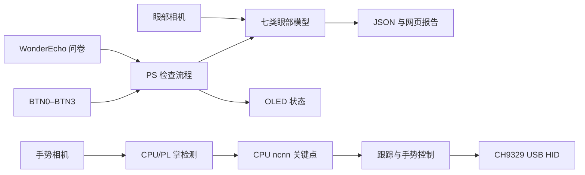

# 系统设计

PYNQ-Z2 的 PS 管理问卷、双摄像机、模型推理、网页报告和手势状态机。PL 保持 UART、两路 I2C、按钮 GPIO，并为掌检测提供六层 FP32 深度卷积加速。关键点网络使用 Cortex-A9 上的 ncnn FP32。

共享 owner 和租约避免各外设重复加载 Overlay。跟踪依赖新帧置信度和真实 ROI 角点，有界裁剪重试修复弯曲漏检，离手暂停输出并保留模式。性能按检测/跟踪、IPC、采集、控制等待和主机输出分层记录。

接口地址、接线和版本依赖见 [系统契约](../skill/pynq-eye-system/references/system_contract.md)，构建见 [构建流程](../skill/pynq-eye-system/references/build_validation.md)，已知实验口径见 [历史基线](current_release.md)。
